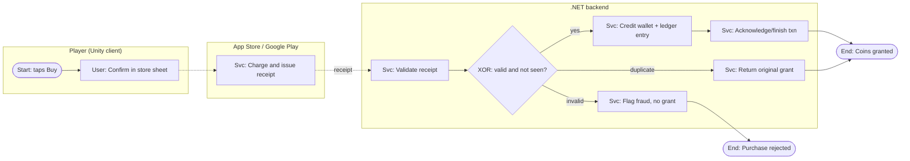
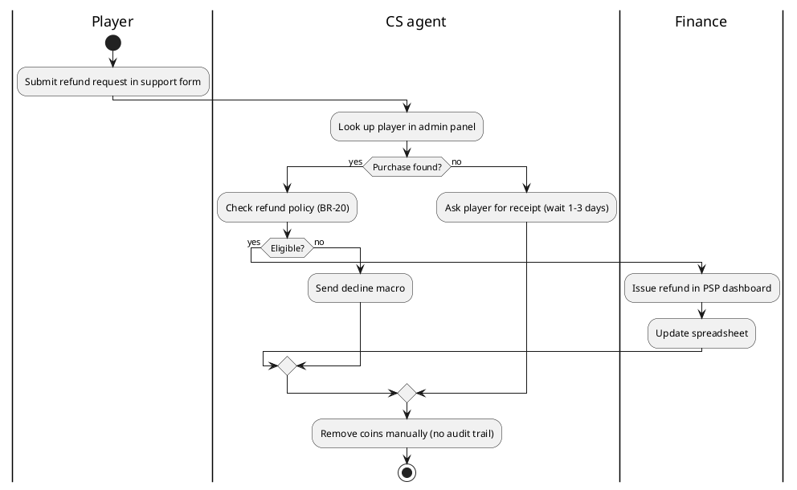

# Process modeling (BPMN-as-text, as-is/to-be, value stream, gaps)

## When to model
- ≥ 2 actors/systems, handoffs, waiting, approvals, money movement, or exceptions → model.
- Single-actor UI flow → user flow (ux-ui-designer) or use case is enough.
- Level of detail: L1 value chain (5–7 boxes) → L2 end-to-end process (≤ 20 nodes) →
  L3 task detail only where a gap or rule lives. One page per diagram; split by subprocess.

## BPMN 2.0 essentials (OMG BPMN 2.0.2)
| Element | Notation meaning | Text convention below |
|---|---|---|
| Start / End event | thin / thick circle | `([Start: trigger])`, `([End: outcome])` |
| Intermediate timer/message | double circle with icon | `{{Timer: 24h}}`, `{{Msg: PSP callback}}` |
| Error / boundary event | lightning on task border | edge label `-.error.->` |
| Task (user, service, script, manual) | rounded rectangle | `[User: Approve refund]`, `[Svc: Credit wallet]` |
| Sub-process | rectangle with + | `[[Sub: KYC check]]` |
| Exclusive gateway (XOR) | diamond X — one path | `{XOR: amount > 500?}` |
| Parallel gateway (AND) | diamond + — all paths, then join | `{AND split}` … `{AND join}` |
| Inclusive gateway (OR) | diamond O — 1..n paths | `{OR: notify channels}` |
| Event-based gateway | diamond pentagon — first event wins | `{EVT: callback or timeout}` |
| Pool / lane | participant / role within it | Mermaid `subgraph`, PlantUML `|Lane|` |
| Sequence vs message flow | solid inside pool / dashed between pools | `-->` vs `-.->` |
| Data object/store | document / cylinder | `[(Ledger DB)]` |
Rules: every gateway that splits is labeled with a question and each outgoing edge with a
condition; parallel splits must join; every path reaches an end event; one start per trigger;
name tasks verb+object ("Verify receipt"), events as state ("Payment received").

## Mermaid flowchart (BPMN-lite) — to-be IAP purchase

Mermaid has no native BPMN; keep the text conventions above consistent. Render check:
GitHub/GitLab render ```mermaid blocks natively.

## PlantUML activity with swimlanes — as-is manual refund

Pain points visible: manual lookup, spreadsheet, wait states, unaudited balance edit → gaps.

## As-is → to-be method
1. Scope: trigger, end outcome, actors, systems; SIPOC first if unclear
   (Suppliers, Inputs, Process 5–7 steps, Outputs, Customers).
2. As-is: model what really happens (observe, logs, CS tickets) — not the official procedure.
3. Annotate each step: actor, system, time, volume/day, error rate, pain (P-n).
4. Root cause on top pains (5 whys / fishbone: people, process, tools, data, policy).
5. To-be: remove, automate, parallelize, move checks earlier, add self-service; keep controls
   (audit, approval thresholds, segregation of duties for money).
6. Gap list → requirements: each gap becomes BR/story with ID; trace back to P-n.
7. Transition requirements: data migration, training, dual-run period, cutover, rollback.

## Gap analysis table
```
| ID  | Area       | As-is                         | To-be                              | Gap / change          | Req IDs        | Priority |
| G-1 | Refund     | CS edits balance manually     | Refund event auto-debits via ledger| automation + audit    | BR-21, US-044  | Must     |
| G-2 | Reporting  | Finance spreadsheet weekly    | Daily recon report from ledger     | new report            | US-047         | Should   |
```
Gap categories: process, people/skills, technology, data, policy/compliance, organization.

## Value stream mapping (lean)
- Per step: Process time (PT, hands-on), Lead time (LT, incl. waiting), %C&A (complete and
  accurate as received by next step).
- Process cycle efficiency `PCE = Σ PT / Σ LT`; knowledge work often < 10–15% (verify:
  Martin & Osterling, "Value Stream Mapping", 2013).
- Rolled %C&A = product of all %C&A → shows rework cost.
- Targets: cut waits (queues, approvals, batch handoffs) before speeding work steps.
```
| Step              | PT    | LT     | %C&A |
| Request feature   | 1h    | 2d     | 60%  |
| Spec + approval   | 4h    | 5d     | 80%  |
| Build + test      | 3d    | 8d     | 90%  |
| Release (store)   | 2h    | 3d     | 95%  |
PCE ≈ 3.7d / 18d ≈ 21%;  rolled %C&A ≈ 41%
```
- Gamedev examples: content pipeline (concept → asset → integrate → live), live-ops event
  setup (design → config → QA → schedule), CS ticket resolution.

## Decision tables (DMN-style) for rule-heavy steps
```
Hit policy: UNIQUE
| Purchase age | Consumed? | Payer tier | → Refund action              |
| ≤ 48 h       | no        | any        | auto refund + debit coins    |
| ≤ 48 h       | yes       | VIP        | manual review                |
| ≤ 48 h       | yes       | non-VIP    | decline (BR-20)              |
| > 48 h       | -         | any        | decline, offer goodwill gift |
```
- Check completeness: product of condition values covered; no overlaps for UNIQUE.
- Hit policies: UNIQUE (one row), FIRST (ordered), COLLECT (all matching) (verify: DMN 1.5 spec).

## State model for business objects
- Model lifecycle of key entities (order, withdrawal, tournament, ticket) as states + events;
  hand detailed state diagrams to system-analyst (diagrams-as-code).
```
Withdrawal: Requested → (KYC ok) Approved → Sent → Settled
            Requested → (KYC fail | RG flag) Rejected;  Sent → (PSP error) Failed → Requested
```

## Review checklist
- [ ] Trigger and outcome stated; every path ends; gateways labeled; splits joined.
- [ ] Lanes = roles/systems, not people's names; message flows between pools only.
- [ ] Exceptions modeled: timeouts, payment failures, duplicates, manual overrides.
- [ ] Each to-be change maps to a gap and a requirement ID.
- [ ] Controls kept for money/data: audit log, approval thresholds, 4-eyes where required.
- [ ] Diagram text renders (Mermaid live editor / PlantUML server) before handoff.

## Sources
- OMG, BPMN 2.0.2 specification https://www.omg.org/spec/BPMN/2.0.2/
- Mermaid flowchart syntax https://mermaid.js.org/syntax/flowchart.html
- PlantUML activity diagram (new syntax) https://plantuml.com/activity-diagram-beta
- OMG, DMN specification https://www.omg.org/spec/DMN/
- Karen Martin & Mike Osterling, "Value Stream Mapping", McGraw-Hill, 2013
- Bruce Silver, "BPMN Method and Style", 2nd ed., Cody-Cassidy Press, 2011
