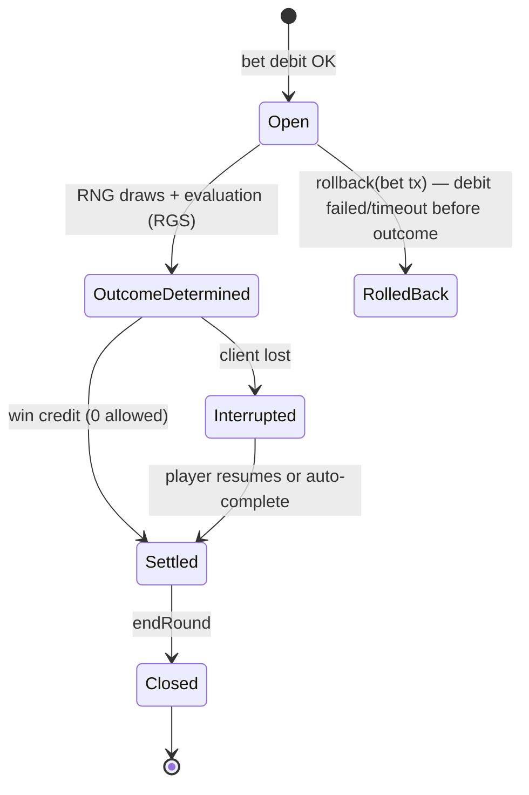

# Wallet, ledger and RGS integration
Applies to RMG, sweepstakes and (simplified) social casino coins. Implementation baseline:
studio:stack-dotnet (EF Core, PostgreSQL/SQL Server, outbox, Testcontainers).

## Components
| Component | Owns | Notes |
|---|---|---|
| PAM (player account management) | identity, KYC, limits, exclusion, wallet | regulated core; often bought (white label) |
| Wallet/ledger | balances, transactions, bonuses, jackpots liabilities | source of financial truth |
| RGS (remote game server) | game logic, RNG calls, math, round state | certified per game/market |
| Aggregator | one API to many RGS studios | adds its own round/transaction IDs |
| Game client (Unity/HTML5) | presentation, input, replay rendering | no outcome logic, no balances of record |

## Wallet modes
- **Seamless wallet** (default for casino): RGS calls the operator wallet per bet/win; balance lives
  in one place. Requires idempotent, low-latency (< ~200 ms p99 target; verify contract SLA) APIs.
- **Transfer wallet**: funds moved into a game-provider sub-wallet; simpler for provider, worse for
  RG limits and reconciliation — avoid for new builds.

## Double-entry ledger
- Every transaction = ≥ 2 entries that sum to zero across accounts; balances are derived
  (or cached with a version and verified against entries). Entries are append-only; fix
  mistakes with compensating transactions, never UPDATE/DELETE.
- Accounts per player: `cash`, `bonus` (locked/unlocked), `pending` (wagers in open rounds);
  house accounts: `ggr_revenue`, `jackpot_liability_<id>`, `payments_clearing`, `bonus_cost`.
- Amounts: `long` minor units + ISO 4217 currency (or `decimal(19,4)`); store FX rate on entry
  for multi-currency; never float.
- Concurrency: one serialized writer per player wallet (row lock `SELECT … FOR UPDATE` or
  optimistic `rowversion` with retry); check non-negative balance inside the same transaction.
- Bet debit order: cash then bonus (or market rule); record the split on the entry for RG and tax.
```csharp
public sealed record LedgerEntry(Guid TxId, string Account, long AmountMinor, string Currency);
public sealed record WalletTx(Guid TxId, string ExternalId, TxType Type, string RoundId,
    IReadOnlyList<LedgerEntry> Entries, DateTimeOffset At)
{
    public void Validate() {
        if (Entries.GroupBy(e => e.Currency).Any(g => g.Sum(e => e.AmountMinor) != 0))
            throw new InvalidOperationException("Unbalanced transaction"); // double-entry invariant
    }
}
// Unique index on (Provider, ExternalId, Type) => replays return the stored result, never re-apply.
```

## Idempotency rules
- Every request carries a unique transaction ID from the caller (RGS/aggregator) + round ID.
- Same ID + same payload → return original result (incl. original balance) with 200;
  same ID + different payload → reject (409) and alert.
- Store idempotency record in the same DB transaction as ledger entries (no "check then write"
  across transactions). Retries from RGS are normal (timeouts) — design for at-least-once.
- Outbound events (round settled, balance changed) via transactional outbox → message bus.

## Round lifecycle (bet → outcome → settle → close; rollback)

| Call | Effect | Edge cases |
|---|---|---|
| `authenticate/session` | token → player, currency, jurisdiction profile | expired token mid-round: settle still accepted |
| `balance` | read | cache-free |
| `bet` (debit) | cash/bonus → pending | insufficient funds → reject; limits/exclusion checked here |
| `win` (credit) | pending → ggr, winnings → player | win without known bet → reject + alert (or accept per contract) |
| `rollback` (refund) | reverse a bet that has no outcome | rollback of unknown tx → store "tombstone" so a late bet is rejected |
| `endRound` | close round, release pending | free spins/features: many wins, one round |
- Rollback only for bets not yet settled; never roll back a settled win (use manual adjustment
  with approval and audit). Features (free spins, bonus rounds) belong to the parent round.
- Timeouts: RGS retries bet; if still unknown, RGS sends rollback; wallet must handle
  bet-after-rollback (reject via tombstone). Reconcile any round open > N minutes (job + alert).

## Reconciliation
- Daily (and intra-day for high volume): per provider, compare RGS round/transaction reports with
  wallet entries (count, sum bets, sum wins, open rounds). Diffs → ticket; never auto-fix silently.
- Ledger invariants job: Σ entries per account = cached balance; Σ all entries per currency = 0;
  pending account = Σ open-round bets.
- Financial close: GGR = bets - wins (- bonus cost per market rule) per game/provider/market;
  feeds regulator reports and tax.

## Logs and replays
- Per round store: round ID, game + math version + build hash, jurisdiction profile, bet, RNG
  draws (values + purpose), outcome symbols/state, each win component, balance before/after,
  bonus usage, timestamps (UTC, NTP), client/session IDs, IP/geo result.
- Replay = re-render from stored outcome (never re-run RNG); same data powers player game recall
  (GLI-19 §4.14), dispute handling and regulator queries.
- Significant events log: logins, failed logins, limit changes, exclusions, admin actions
  (who/what/when, before/after), configuration and math changes, jackpot events.
- Retention per market (≥ 5 years common for financial/AML records; verify). Logs are append-only
  and access-controlled; PII minimized and separated (studio:compliance-advisor privacy).

## Bonus abuse and fraud
| Threat | Signals | Controls |
|---|---|---|
| Multi-accounting (bonus farming) | shared device/IP/payment/address, KYC duplicates | device fingerprint, KYC before bonus withdraw, one bonus per household rule |
| Low-risk wagering of bonus | even-money both sides, low-volatility games | game weighting, max bet while wagering, excluded games |
| RTP/feature arbitrage | play only high-RTP variant or buggy feature | market-consistent variants, anomaly alerts on per-game player return |
| Chip dumping/collusion (P2P) | one-way transfers, soft play | pattern detection, account linking |
| Stolen cards / chargebacks | new account, high deposit, fast withdraw | 3DS, velocity limits, closed loop, chargeback → lock + review |
| Account takeover | new device + password reset + withdrawal | 2FA, withdrawal holds on credential change |
| Bots/scripting | inhuman timing, 24/7 play | rate limits, behavioural detection, CAPTCHA at risk |
| Geo spoofing | VPN, GPS mock, timezone mismatch | certified geolocation, block on fail |
| Affiliate fraud | fake sign-ups, incentivized traffic | CPA holds, quality metrics |
| Social coins resale/gifting | many gifts to one account, external market listings | caps on gifts, no transfer of purchased coins |
- Security reviews: security-engineer owns threat model; payment data via PSP tokens only (PCI DSS scope minimal).

## Tests that must exist (qa-engineer)
- Idempotent replay of every call; out-of-order bet/rollback; win for unknown bet; concurrent bets
  on one wallet; insufficient funds; limit/exclusion hit at debit; interrupted round resume;
  currency precision; reconciliation diff detection; replay matches original outcome.

## Sources
- GLI-19 Standards for Interactive Gaming Systems v3.0 (2020) — §2.8 records, §4.14 recall, §4.16 interrupted games https://gaminglabs.com/wp-content/uploads/2024/06/GLI-19-Interactive-Gaming-Systems-v3.0.pdf
- Martin Kleppmann, "Designing Data-Intensive Applications" (O'Reilly, 2017) — idempotence, transactions, exactly-once semantics.
- Microsoft, transactional outbox pattern https://learn.microsoft.com/azure/architecture/databases/guide/transactional-outbox-cosmos
- Stripe engineering, "Designing robust and predictable APIs with idempotency" https://stripe.com/blog/idempotency
- PCI Security Standards Council https://www.pcisecuritystandards.org/
