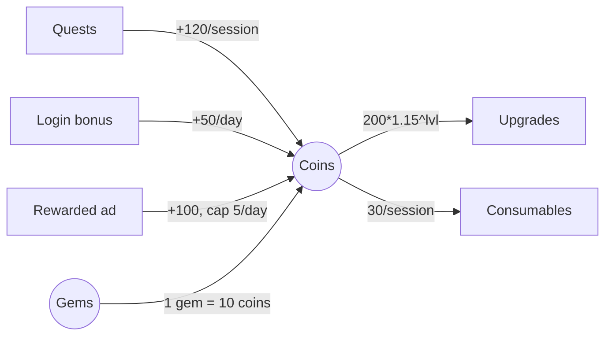

# Virtual economy design (practitioner reference)

## Vocabulary (Machinations-style nodes)
| Node | Meaning | Game example |
|---|---|---|
| Source (faucet) | creates resource from nothing | quest reward, login bonus, ad reward, slot win |
| Pool | stores resource | wallet, inventory, energy bar |
| Drain (sink) | destroys resource | upgrade cost, repair, consumable, entry fee, slot bet (house edge) |
| Converter | turns A into B | crafting, gem→coin exchange, shard→hero |
| Trader | swaps between players/pools | marketplace, gifting (fraud vector) |
| Gate | routes flow by rule/probability | loot table, gacha, pity |
| Register | computed value driving rules | player level, VIP tier, bet unlock |
| Delay/Queue | time-gated flow | build timers, energy refill |
- Positive feedback (rich get richer: income buildings) amplifies inequality; pair it with
  negative feedback (rising costs, caps, catch-up mechanics).

## Currency types
| Type | Earned via | Bought | Typical sinks | Rules |
|---|---|---|---|---|
| Soft (coins/gold) | core loop, quests | yes (via hard) | upgrades, consumables, cosmetics tier 1 | high volume, inflates first; strongest sinks |
| Hard/premium (gems) | IAP, small free trickle | yes | speed-ups, gacha, premium items, pass | never expire (Apple 3.1.1); price anchor = real money |
| Event/seasonal | event play only | rarely | event shop | expires or converts at season end; announce conversion rate |
| Energy/stamina | regen over time | refill | play sessions | caps session length; refill price = key pricing lever |
| Tokens/shards | duplicates, drops | indirectly | targeted unlocks | bad-luck protection for gacha |
| Social casino coins | bonuses, wins | yes | bets | no cash value, no cash-out (casino-math.md) |
| Sweepstakes coins | AMOE, purchase bonus | never directly | bets | redeemable → gambling law (studio:domain-igaming) |
- Default: 1 soft + 1 hard + bounded event currency. Every additional currency needs a reason;
  EU CPC (2025) principles discourage multi-currency setups that obscure real cost.
- Fix the hard-currency anchor: e.g. 100 gems ≈ USD 0.99 base pack; keep it constant across tiers
  (bonus gems on bigger packs), so item prices map to money transparently.

## Value chains
- Each resource must lead, through visible steps, to an anchor motivation (power, collection,
  self-expression, social status). A resource without an anchor gets hoarded or ignored.
- Sinks should slightly exceed sources so the chain stays "taut" (Cook, Lost Garden 2021);
  diagnose "why am I playing?" feedback as a broken or hidden link.
- Write each chain as: `action → output → used in → output → … → anchor`.

## Flow diagram (Mermaid; one per currency)


## Targets and metrics
| Metric | Formula | Use |
|---|---|---|
| Earn rate | Σ sources per session / per DAU-day | pacing; compare with sink prices |
| Sink/source ratio | Σ destroyed / Σ created (per period, per segment) | < 1 accumulates (inflation), > 1 drains |
| Time-to-goal | cost(goal) / earn rate (non-payer) | each milestone needs a target in days |
| Inflation index | median balance / median price of next meaningful purchase | > ~3 means sinks are not biting |
| Net flow per DAU | (sources - sinks)/DAU, by day-since-install | drift detection in live data |
| Hoard ratio | balance held by top 1% / total | whale/bot concentration, exploit signal |
- Practitioner heuristics (tune per game, not sourced norms): early game ratio < 1 (feel rich),
  mid-game trend to 0.9-1.0, end-game sinks (prestige, cosmetics, rerolls) absorb surplus.
- Segment everything by archetype: non-payer, minnow, dolphin, whale; casual/core; and by
  day-since-install. Averages hide the long tail that breaks economies.

## Cost and reward curves
| Curve | Formula | Feel | Use |
|---|---|---|---|
| Linear | c0 + k·n | flat, predictable | consumables, early levels |
| Polynomial | c0·n^p (p 1.5-2.5) | steadily harder | XP per level |
| Geometric | c0·g^n (g 1.05-1.2) | explosive late | idle games, upgrade levels (needs prestige reset) |
| Piecewise | table per band | designer control | real games: polynomial early, geometric late |
- Pair curves: if income grows geometrically (idle), costs must grow faster (g_cost > g_income)
  or progress becomes trivial.
- Keep curves in config (ScriptableObject/remote config), not code; version each change.

## Inflation control toolbox
- Caps: wallet cap, daily earn caps on ads/gifts, event currency cap.
- Decay/expiry: event currency converts at season end; energy over-cap stops regen.
- Scaling sinks: costs indexed to level/progress; repair/maintenance fees proportional to power.
- Lottery sinks: rerolls, cosmetic gacha for soft currency (watch disclosure rules if paid).
- Prestige/rebirth: resets progress for permanent multipliers (idle genre standard).
- Trading friction: marketplace fee (5-15% typical, verify per title), listing caps, trade locks.
- Never retroactively devalue purchased currency; inflate sink prices only for new content.

## Archetype simulation (Monte Carlo)
- Model per day: sessions ~ distribution from data (or assumption), earnings per session,
  spend policy (when affordable, probability p), purchases (payers only, price/frequency).
- Report percentiles (p50/p90/p99) of balance, level and sink/source per archetype at D1/D7/D30/D90.
- Fixed seed for reproducibility; N ≥ 5,000 players per archetype; rerun after every curve change.
```python
# Monte Carlo soft-currency economy: N players x D days -> balance percentiles, sink/source ratio.
import random, statistics as st
def player_day(rng, day, s):
    sessions = max(0, int(rng.gauss(3, 1.2)))                      # sessions/day ~ N(3, 1.2)
    earn = 50 + sum(rng.randint(80, 140) for _ in range(sessions))  # login bonus + per-session loot
    if day % 7 == 6: earn += 500                                    # weekly event reward
    s["bal"] += earn; s["src"] += earn
    cost = int(200 * 1.15 ** s["lvl"])                              # upgrade cost curve (geometric)
    while s["bal"] >= cost and rng.random() < 0.8:                   # 80% spend when affordable
        s["bal"] -= cost; s["snk"] += cost; s["lvl"] += 1; cost = int(200 * 1.15 ** s["lvl"])
    burn = min(s["bal"], 30 * sessions); s["bal"] -= burn; s["snk"] += burn   # consumables
def run(n=5000, days=30, seed=7):
    rng = random.Random(seed); out = {}
    players = [{"bal": 0, "src": 0, "snk": 0, "lvl": 0} for _ in range(n)]
    for d in range(days):
        for s in players: player_day(rng, d, s)
        if d + 1 in (1, 7, 30):
            b = sorted(p["bal"] for p in players); q = lambda t: b[int(t * (n - 1))]
            ratio = sum(p["snk"] for p in players) / sum(p["src"] for p in players)
            out[d + 1] = dict(p50=q(.5), p90=q(.9), p99=q(.99), lvl50=st.median(p["lvl"] for p in players),
                              sink_source=round(ratio, 3))
    return out
if __name__ == "__main__":
    for day, r in run().items(): print(f"D{day}: {r}")
```
- Output of this exact script (Python 3.12, seed 7): D7 p50 = 308 coins, sink/source 0.856;
  D30 p50 = 671, sink/source 0.941, median level 15 — i.e. sinks tighten as costs scale.
- Extend: add archetype param dicts (sessions mean, purchase prob), a gem converter, an event
  shop; vectorize with numpy for > 10^6 player-days; for visual node graphs use Machinations.io.
- Validate the model against live telemetry after soft launch; recalibrate inputs, not outputs.

## Rebalance and migration
- Change one lever per release; A/B pricing only within platform rules and consumer law
  (no misleading "discounts" vs never-charged reference prices).
- Before a nerf/devaluation: simulate holders' impact, compensate (refund currency at old value),
  announce in patch notes; log as ADR (tech/design decision) and risk.
- Migrations of balances are server-side, idempotent, audited (ledger entries, not overwrites).

## Telemetry (hand to data-analyst)
- `currency_change {currency, delta, balance_after, source_or_sink, item_id, context, txn_id}` on
  the server, every change; client events only for UI funnels.
- Daily aggregates: created/destroyed per currency per segment; top sources/sinks; hoard ratio.
- Alerts: net flow per DAU outside band 3 days in a row; single-account earn > p99.9 (exploit/bot).

## Server authority
- All balances and reward rolls live on the server; client shows cached values. Purchases
  credited only after receipt validation (App Store Server API / Google Play Developer API).
- Implementation patterns: studio:stack-dotnet; wallet ledger: studio:domain-igaming
  (references/wallet-and-rgs-integration.md) applies to any virtual currency.

## Sources
- Joris Dormans, Ernest Adams, "Game Mechanics: Advanced Game Design" (New Riders, 2012) — Machinations framework.
- Machinations documentation https://machinations.io/docs/
- Daniel Cook, "Value chains" (Lost Garden, 2021) https://lostgarden.com/2021/12/12/value-chains/
- CPC Network key principles on in-game virtual currencies (2025-03-21), summary https://www.zwillgen.com/gaming/cpcn-announces-virtual-currency-consumer-protection-guidelines/
- Apple App Review Guidelines 3.1.1 (currencies may not expire) https://developer.apple.com/app-store/review/guidelines/
- Deconstructor of Fun (economy and monetization teardowns) https://www.deconstructoroffun.com/
