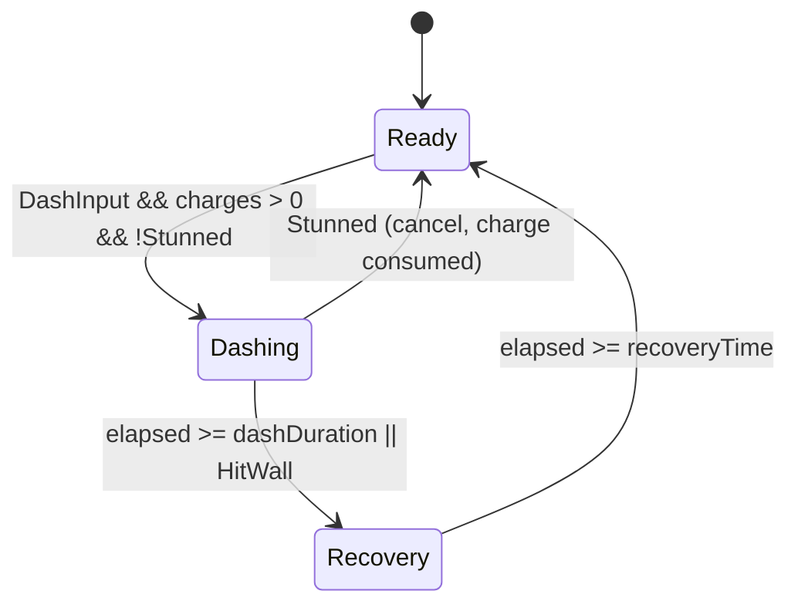

# Writing implementable mechanic specs (for Unity devs)

Goal: unity-developer and qa-engineer can build and test the feature with zero design
questions. Use the feature-spec template from `studio:lead-game-designer`.

## Anatomy (order matters)
1. Intent — aesthetic + pillar + player problem (2 lines).
2. Player-facing behaviour — numbered steps of what the player does and sees/hears/feels.
3. Rules — table: `ID | trigger | effect | duration | exceptions/stacking`.
4. States — diagram + transition table; each state lists allowed inputs.
5. Parameters — table → ScriptableObject/remote config; no numbers in prose.
6. Edge cases — checklist below, each with expected behaviour.
7. Feedback hooks — named events for VFX/SFX/haptics/UI (`OnDashStart`, `OnDashHit`).
8. Telemetry — events + params + the question each answers.
9. Acceptance criteria — Given/When/Then, one behaviour each.
10. Out of scope + open questions (owner, due date).

## Rule-writing conventions
- Use RFC-style verbs: MUST / MUST NOT / MAY. One rule per row, unique ID (`DASH-R3`)
  so code comments, tests and bugs can cite it.
- Time in seconds (float) for gameplay; frames only for animation/feel at a stated rate.
  Physics runs in `FixedUpdate` (default 0.02 s = 50 Hz) — say if a rule is physics-step bound.
- Units: metres, m/s, degrees, %, as 0–1 floats in data but % in UI text. State coordinate
  space (world/local/screen) and axis conventions when relevant.
- Randomness: state distribution, seed policy, and authority (client cosmetic vs server for
  economy/PvP). Never "random chance" without p.
- Ordering: state resolution order when rules fire together (e.g. damage → shield → death
  check → on-kill effects). Ambiguous order is the #1 source of bugs.
- Stacking: refresh vs extend vs stack-count vs ignore; max stacks.
- Interrupts: what cancels the action (damage, stun, input, death, pause, scene change).

## States (example: Dash)

| State | Entry | Allowed input | Exit | Notes |
|---|---|---|---|---|
| Ready | spawn / recovery end | move, attack, dash | dash input | charges regen per `chargeRegenTime` |
| Dashing | dash input valid | none (buffer dash/attack) | duration / wall / stun | i-frames for `invulnWindow` |
| Recovery | dash end | move at `recoveryMoveScale` | timer | buffered input fires on exit |

## Parameters → ScriptableObject
| Name | Type | Default | Range | Unit | Live-tunable | Notes |
|---|---|---|---|---|---|---|
| dashDistance | float | 4.0 | 2–8 | m | no | measured on flat ground |
| dashDuration | float | 0.18 | 0.1–0.3 | s | no | |
| invulnWindow | Vector2 | (0.02, 0.15) | within duration | s | no | start/end offsets |
| maxCharges | int | 2 | 1–3 | count | yes | remote config key `dash.maxCharges` |
| chargeRegenTime | float | 1.5 | 0.5–5 | s | yes | |
| speedCurve | AnimationCurve | ease-out | 0–1 | normalised | no | key list in spec |
- Suggest the SO shape; unity-developer owns final code. Designers edit assets in Inspector.
```csharp
[CreateAssetMenu(menuName = "Game/Config/Dash")]
public sealed class DashConfig : ScriptableObject {
    [Range(2f, 8f), Tooltip("m")] public float dashDistance = 4f;
    [Range(0.1f, 0.3f), Tooltip("s")] public float dashDuration = 0.18f;
    public Vector2 invulnWindow = new(0.02f, 0.15f);
    [Range(1, 3)] public int maxCharges = 2;
    public AnimationCurve speedCurve = AnimationCurve.EaseInOut(0, 1, 1, 0);
    void OnValidate() => invulnWindow.y = Mathf.Min(invulnWindow.y, dashDuration);
}
```
- Large/content tables (units, levels, items): CSV in `.team/specs/gdd/data/` with stable
  string IDs → editor importer → SO assets. Never reference rows by index.
- Live-tunable values: name the remote-config key, default when offline, and safe range
  (clamped in code).

## Edge-case checklist (answer each: expected behaviour)
- Value at 0, at max, negative/overflow; empty inventory/list; last enemy/item.
- Input spam, simultaneous inputs, input during transitions, controller disconnect.
- Interrupt by damage/stun/death/pause/menu; scene unload mid-action; time scale = 0.
- Mobile: app backgrounded/killed mid-action; low-end device frame drops (rules frame-rate
  independent?); notch/safe area for UI.
- Save/load mid-state (what persists, what resets); offline → online sync.
- Multiplayer: latency, prediction/rollback, authority, two players same target same tick
  (→ multiplayer-network-engineer).
- Localization/UI: longest string, RTL (→ narrative-designer, ux-ui-designer).

## Acceptance criteria
- Format: `Given <state/context>, when <action>, then <observable result within tolerance>`.
- Observable and measurable: "then the player moves 4.0 m ± 0.1 m within 0.18 s" not
  "dash feels good". Feel targets are verified separately in a playtest.
- Cover: happy path, each rule ID, each edge case marked must-handle, telemetry fired.
- Example: Given 0 charges, when Dash is pressed, then no dash occurs, the "no charge" SFX
  plays, and `dash_denied{reason:"no_charges"}` is logged.

## Asks to engineering (include when relevant)
- Debug menu/cheats (set charges, god mode, jump to level), tuning scene/"metrics gym",
  on-screen debug of states/timers, telemetry validation view.

## Common spec defects (review before handoff)
- Missing resolution order; undefined interrupt; numbers in prose; "etc."/"and so on";
  undefined terms (define glossary once in GDD); no out-of-scope; AC not testable;
  feel adjectives without numbers; economy effects not flagged.

## Sources
- Unity Manual, ScriptableObject https://docs.unity3d.com/Manual/class-ScriptableObject.html
- Unity Manual, Time and fixed timestep https://docs.unity3d.com/Manual/fixed-updates.html (verify: page name for Unity 6)
- RFC 2119, "Key words for use in RFCs to Indicate Requirement Levels" https://www.rfc-editor.org/rfc/rfc2119
- Mermaid state diagrams https://mermaid.js.org/syntax/stateDiagram.html
- Unity e-book "Create modular game architecture with ScriptableObjects" https://unity.com/resources/create-modular-game-architecture-with-scriptable-objects-ebook
