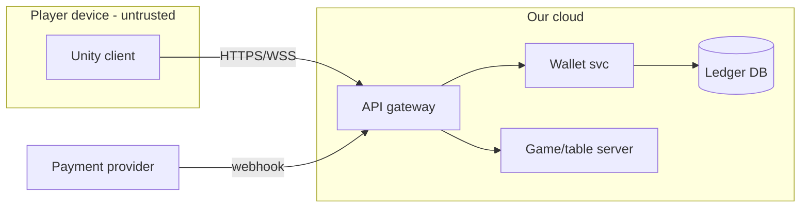

# Threat modeling (practitioner reference)

## The four questions (Shostack / Threat Modeling Manifesto)
1. What are we working on? → DFD + assets + trust boundaries.
2. What can go wrong? → STRIDE per element, attack trees for high-value goals.
3. What are we going to do about it? → mitigate / eliminate / transfer / accept (with owner).
4. Did we do a good job? → review coverage, validate mitigations with tests.
Timebox: 60–90 min session per feature; whole-system model refreshed per major release.

## Data-flow diagram (DFD) elements
| Element | Symbol | Examples (game/casino) |
|---|---|---|
| External entity | rectangle | player client (Unity), PSP (Stripe/Adyen), App Store/Play, admin user |
| Process | circle | API gateway, wallet service, game server, matchmaker |
| Data store | parallel lines | Postgres ledger, Redis sessions, S3 replays, PlayerPrefs on device |
| Data flow | arrow | HTTPS REST, WebSocket/SignalR, UDP game packets, webhooks |
| Trust boundary | dashed line | internet ↔ edge, client device ↔ server, service ↔ third party, prod ↔ admin network |
Write DFDs as Mermaid in the artifact so they diff in git:


## STRIDE (per element type)
| Threat | Property violated | Applies to | Typical game/casino example | Standard mitigations |
|---|---|---|---|---|
| Spoofing | authentication | entity, process | stolen session token, fake PSP webhook | OIDC/JWT validation, mTLS, webhook HMAC signature check |
| Tampering | integrity | process, store, flow | modified bet amount, edited save file, packet edit | server authority, input validation, signatures/MAC, TLS |
| Repudiation | non-repudiation | entity, process | "I never placed that bet" | append-only audit log with user, time, request ID; signed records |
| Information disclosure | confidentiality | process, store, flow | other players' hands visible, PII in logs, IDOR | authz per object, encryption, minimal responses, interest management |
| Denial of service | availability | process, store, flow | lobby flood, expensive queries, UDP amplification | rate limits, quotas, timeouts, autoscaling, DDoS protection |
| Elevation of privilege | authorization | process | player calls admin endpoint, mass assignment sets `IsAdmin` | deny-by-default, role/policy checks, DTO allowlists |
- Flows crossing a trust boundary get the full STRIDE pass; internal flows get T, I, D at minimum.
- Add LINDDUN (privacy) when PII/profiling is in scope; add "fairness/cheating" as a game-specific
  category: any client-controlled input that changes outcomes.

## Attack trees (for high-value goals)
```
GOAL: Withdraw money not won
├─ OR Manipulate game outcome
│  ├─ Predict RNG (weak seed, client-side RNG)              → server CSPRNG, certified RNG
│  └─ Tamper result message (client reports win)            → server computes outcome
├─ OR Double-spend wallet
│  ├─ Race concurrent bet/withdraw requests                 → serializable txn / row version, idempotency key
│  └─ Replay successful credit request                      → nonce + idempotency, signed server-to-server
├─ OR Take over another account
│  ├─ Credential stuffing                                   → rate limit, breached-password check, MFA
│  └─ Session token theft (XSS, logs, insecure storage)     → HttpOnly cookies / secure storage, short TTL
└─ OR Abuse bonus (multi-accounting, chip dumping)          → device/payment fingerprint, collusion analytics
```
- Mark each leaf with cost/skill for the attacker; mitigate cheap leaves first.

## Risk rating
| Approach | Use |
|---|---|
| Likelihood × Impact (1–5 each, OWASP Risk Rating factors) | design-time threats; score ≥ 15 high, 8–14 medium, ≤ 7 low |
| CVSS v4.0 base + threat/environmental | concrete vulnerabilities in code/deps (FIRST, 2023) |
| EPSS + CISA KEV | prioritize CVEs actually exploited in the wild |
| DREAD | avoid — subjective, Microsoft stopped using it |
Impact anchors for this studio: 5 = real-money loss / regulatory breach / mass account takeover;
4 = economy inflation, competitive-integrity loss, PII exposure; 3 = single-account harm, partial
outage; 2 = cosmetic exploit; 1 = negligible.
Likelihood anchors: 5 = public tool/cheat exists, unauthenticated; 3 = needs a modded client;
1 = needs insider access + multiple chained bugs.

## Mitigation decision rules
- Money, RNG, progression, inventory, match results → eliminate client trust (move to server).
- Data at rest on device → assume readable; store only what's needed, encrypt tokens with
  platform keystore (Android Keystore / iOS Keychain).
- Third-party webhooks → verify signature, timestamp tolerance (≤ 5 min), idempotent processing.
- Accepting a risk requires owner (role), rationale, review date in `.team/risks.md`.

## Tools
- OWASP Threat Dragon (open source, DFD + STRIDE), Microsoft Threat Modeling Tool (Windows, STRIDE
  templates), or Mermaid in markdown (cheapest, reviewable in PRs). Prefer Mermaid for the team.

## Session checklist
- [ ] DFD has all entities, stores, flows; every flow labeled with protocol + auth method.
- [ ] Trust boundaries drawn; every boundary-crossing flow STRIDE-analyzed.
- [ ] Assets listed with impact anchor; attacker profiles listed.
- [ ] Each threat: rating, mitigation, owner, status; top 3 risks into `.team/risks.md`.
- [ ] Security requirements fed back into specs/stories with acceptance criteria.

## Sources
- Adam Shostack, "Threat Modeling: Designing for Security" (Wiley, 2014)
- Threat Modeling Manifesto https://www.threatmodelingmanifesto.org/
- OWASP Threat Modeling Cheat Sheet https://cheatsheetseries.owasp.org/cheatsheets/Threat_Modeling_Cheat_Sheet.html
- OWASP Risk Rating Methodology https://owasp.org/www-community/OWASP_Risk_Rating_Methodology
- FIRST CVSS v4.0 Specification https://www.first.org/cvss/v4-0/specification-document
- Bruce Schneier, "Attack Trees" (Dr. Dobb's Journal, 1999) https://www.schneier.com/academic/archives/1999/12/attack_trees.html
- OWASP Threat Dragon https://owasp.org/www-project-threat-dragon/
