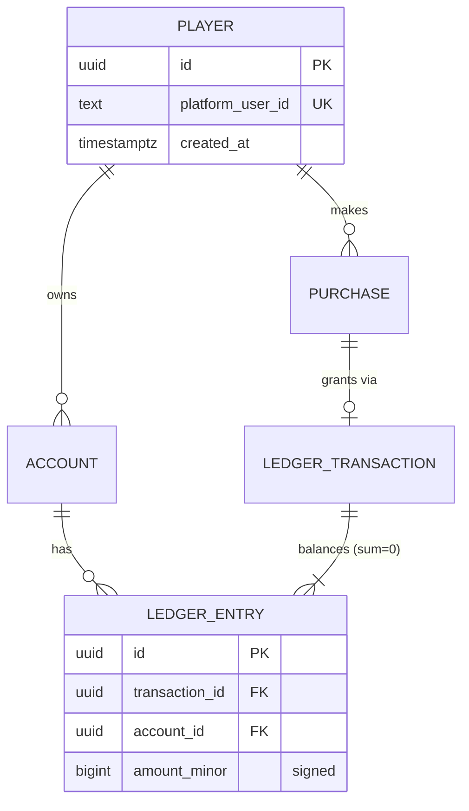

# Data modeling (logical → physical hints)

## Process
1. Nouns from stories/BRs → candidate entities; verbs → relationships/events.
2. For each entity: identity (key), lifecycle states, owner service, volume (rows/day), retention.
3. Relationships with cardinality + optionality; resolve M:N with associative entities.
4. Attributes with type, nullability, constraints, PII class → data dictionary.
5. Invariants (must always hold) → DB constraints where possible, else domain logic + tests.
6. Access patterns (top queries, write rate) → indexes, denormalization, read models.

## Keys & common columns
- Surrogate key: UUIDv7 or ULID (time-ordered → index-friendly) or `bigint identity` internally;
  expose opaque string IDs in APIs. Natural keys (store txn ID, email) → unique constraints.
- Standard columns: `created_at`, `updated_at` (UTC `timestamptz`), `version`/row version for
  optimistic concurrency, `created_by` for back-office writes.
- Soft delete (`deleted_at`) only when restore/audit needs it; filtered unique indexes then.
- Enums: text + CHECK or lookup table; never magic ints shared with clients.

## Normalization vs denormalization
| Form | Rule | Violation symptom |
|---|---|---|
| 1NF | atomic values, no repeating groups | comma lists in a column, `item1,item2` |
| 2NF | non-key attrs depend on whole composite key | product name stored on order line |
| 3NF / BCNF | no transitive dependency (non-key → non-key) | `country_name` beside `country_code` |
- OLTP default: 3NF; denormalize deliberately with a named reason: read hot path (profile
  snapshot), historical fact (price at purchase time — this is NOT redundancy), or analytics.
- JSONB columns for sparse/versioned config or vendor payloads; never for fields you filter/join on
  frequently or enforce constraints on.
- Analytics store (ClickHouse/BigQuery) is denormalized, append-only, wide events — separate
  from OLTP; feed via CDC/outbox, not dual writes (data-analyst owns the warehouse model).

## ER diagram (Mermaid)

Cardinality: `||` exactly one, `o|` zero or one, `}|` one or more, `}o` zero or more.

## Wallet / ledger schema (double-entry)
Principles: immutable append-only entries; every transaction's entries sum to zero per currency;
balances derived (or cached with version check); corrections = reversing transaction, never UPDATE.
```sql
CREATE TABLE account (
  id            uuid PRIMARY KEY,
  owner_type    text NOT NULL CHECK (owner_type IN ('PLAYER','HOUSE','PSP_CLEARING','PROMO','REVENUE')),
  owner_id      text NOT NULL,
  currency      text NOT NULL,                 -- 'COINS', 'GEMS', 'USD'
  balance_minor bigint NOT NULL DEFAULT 0,     -- cached; source of truth = entries
  version       bigint NOT NULL DEFAULT 0,
  allow_negative boolean NOT NULL DEFAULT false,
  UNIQUE (owner_type, owner_id, currency)
);
CREATE TABLE ledger_transaction (
  id              uuid PRIMARY KEY,
  kind            text NOT NULL,      -- PURCHASE_GRANT, BET, WIN, REFUND, ADMIN_GRANT, REVERSAL
  idempotency_key text NOT NULL UNIQUE,  -- e.g. 'gp:' || order_id, 'bonus:' || player || ':' || day
  reverses_id     uuid REFERENCES ledger_transaction(id),
  reason_code     text, actor text NOT NULL,   -- 'system' | staff id
  created_at      timestamptz NOT NULL DEFAULT now()
);
CREATE TABLE ledger_entry (
  id             bigint GENERATED ALWAYS AS IDENTITY PRIMARY KEY,
  transaction_id uuid NOT NULL REFERENCES ledger_transaction(id),
  account_id     uuid NOT NULL REFERENCES account(id),
  amount_minor   bigint NOT NULL CHECK (amount_minor <> 0),  -- + credit / - debit
  balance_after  bigint NOT NULL,
  created_at     timestamptz NOT NULL DEFAULT now()
);
CREATE INDEX ON ledger_entry (account_id, id);
```
- Write path (one DB transaction): insert `ledger_transaction` (unique key = dedupe) → lock or
  version-check accounts (`UPDATE account SET balance_minor = balance_minor + $d, version =
  version + 1 WHERE id = $a AND version = $v AND (allow_negative OR balance_minor + $d >= 0)`) →
  insert entries → outbox row `wallet.credited`. Zero rows updated → retry or insufficient funds.
- Lock ordering: update accounts in ascending ID order to avoid deadlocks.
- Holds/reservations (bets in flight, pending withdrawals): separate `HOLD` account or
  `reserved_minor` column; settle or release by transaction.
- Reconciliation jobs: Σ entries per transaction = 0; cached balance = Σ entries; daily PSP/store
  report vs PURCHASE rows; alert on drift.
- Virtual vs real money: same pattern; real money adds regulatory retention (often 5+ years),
  segregation of player funds, and audit export (verify per jurisdiction via compliance-advisor).
- Amount types: `bigint` minor units (cents, or 1 coin); `numeric(20,4)` only where fractional
  rates required; never `float/double`.

## State modeling for entities
- Store `status` + `status_changed_at`; allowed transitions in one place (domain + CHECK/trigger
  optional); history table for audit (`entity_status_history`).
- Document as Mermaid `stateDiagram-v2` (diagrams-as-code.md) with guards and side effects.

## Event sourcing basics
| Use when | Avoid when |
|---|---|
| audit is the product (ledger, compliance), temporal queries "state at T" | simple CRUD, reporting-heavy domains |
| complex domain with many state changes, need to rebuild projections | team new to it + tight deadline |
- Concepts: event store (append-only stream per aggregate, `stream_id, version` unique →
  optimistic concurrency), aggregate rebuilt by folding events, snapshots every N events
  (e.g. 100–500), projections/read models updated asynchronously (eventually consistent).
- Events are immutable facts in past tense; schema evolution via upcasters / versioned types;
  never delete — GDPR via crypto-shredding (per-subject key) or PII kept outside events.
- .NET options: Marten (PostgreSQL), EventStoreDB/KurrentDB (verify current naming/licensing).
- Pragmatic middle ground: state tables + immutable ledger/audit + outbox events (most games).

## Temporal & history patterns
- Price/config at time of use → copy into the fact row (purchase stores price, SKU version).
- Slowly changing dimensions (analytics): SCD type 2 (`valid_from`, `valid_to`, `is_current`).
- Config versions: immutable `config_version` rows + pointer to active; rollback = switch pointer.

## PII & retention
- Classify each attribute: Public / Internal / Confidential / PII / Sensitive PII (payment,
  ID docs, health, precise location). Minimize; tokenize payment data (PSP vault, never store PAN).
- Retention per table with legal basis; erasure strategy: delete, anonymize, or pseudonymize
  (ledger retained for finance law, player identity unlinked). Consent records are themselves data.
- Mark PII in the data dictionary and in OpenAPI (`x-pii: true`) for logging redaction.

## Data dictionary template
```
| Entity.attribute | Type | Null | Constraints / domain | Default | PII | Source / owner | Description |
| account.currency | text | no   | ISO 4217 or 'COINS','GEMS' | - | no | wallet-svc | Ledger currency |
| player.email     | text | yes  | RFC 5322, unique lower()   | - | PII | auth-svc  | Login + receipts |
```
Plus per entity: purpose, owner service, est. rows/day, retention, key access patterns, indexes.

## Review checklist
- [ ] Every BR invariant enforced (constraint, unique index, or tested domain rule).
- [ ] Money as integers/decimal; ledger balances; corrections by reversal only.
- [ ] Idempotency natural keys unique (store order ID, bonus day, event ID).
- [ ] Hot queries have supporting indexes; pagination uses keyset columns.
- [ ] Timestamps UTC `timestamptz`; time zones only at presentation.
- [ ] PII classified, retention + erasure defined; audit for back-office writes.

## Sources
- Martin Fowler, "Event Sourcing" https://martinfowler.com/eaaDev/EventSourcing.html
- Martin Kleppmann, "Designing Data-Intensive Applications", O'Reilly, 2017
- Mermaid entity relationship diagrams https://mermaid.js.org/syntax/entityRelationshipDiagram.html
- PostgreSQL docs, Constraints https://www.postgresql.org/docs/current/ddl-constraints.html
- Modern Treasury, "Accounting for developers" (ledger design) https://www.moderntreasury.com/journal/accounting-for-developers-part-i
- Marten event store docs https://martendb.io/events/
- RFC 9562 UUIDs incl. UUIDv7 https://www.rfc-editor.org/rfc/rfc9562.html
