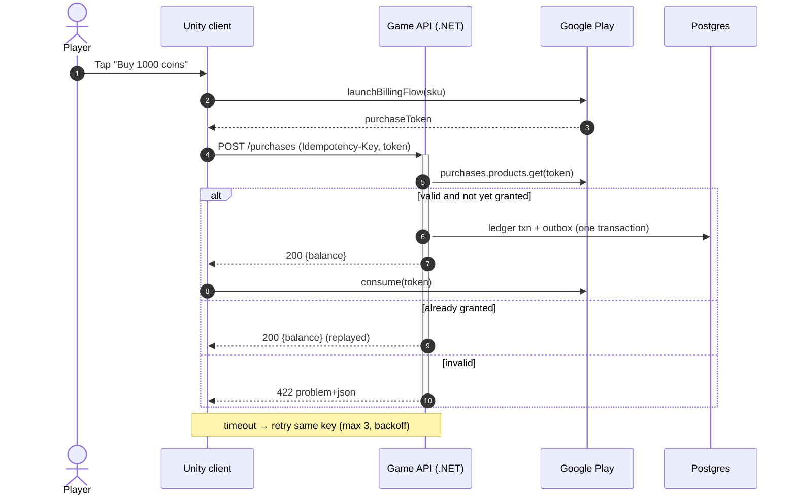
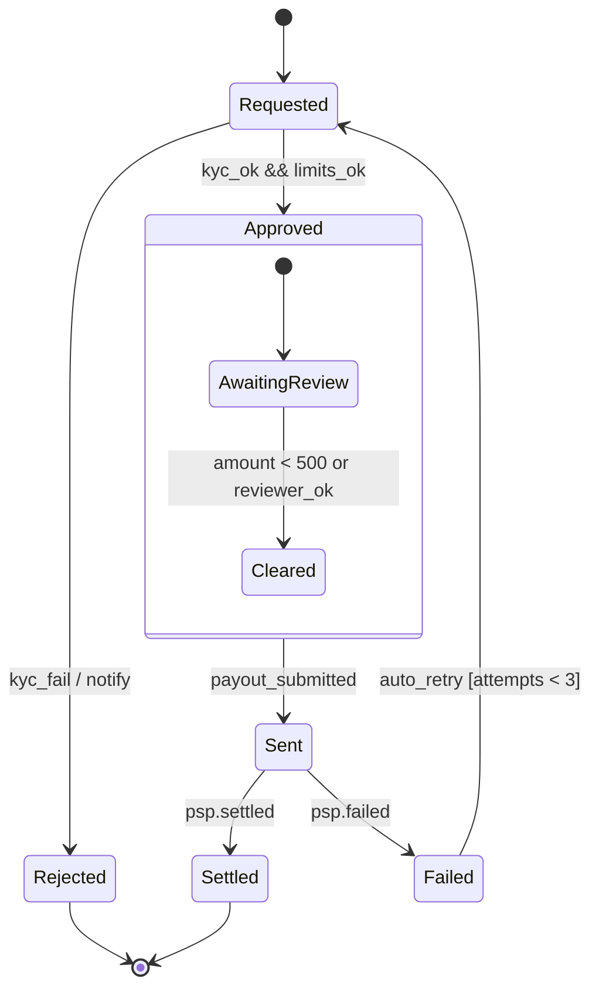
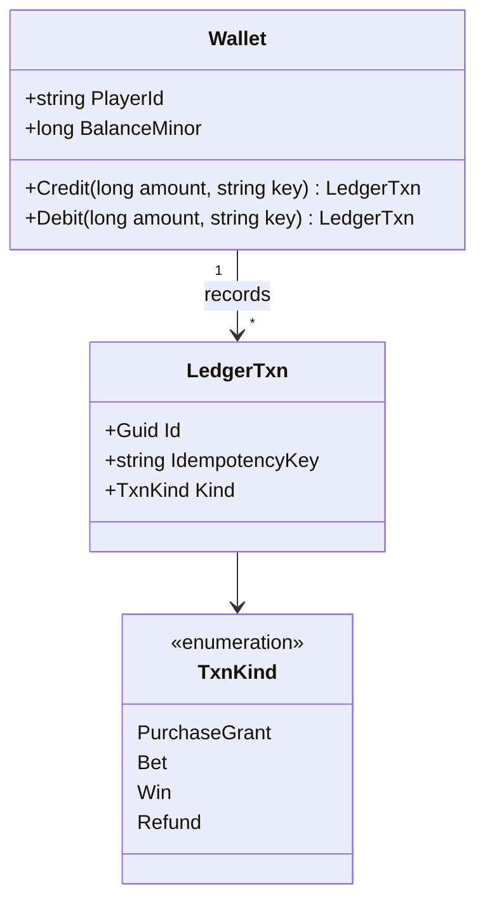
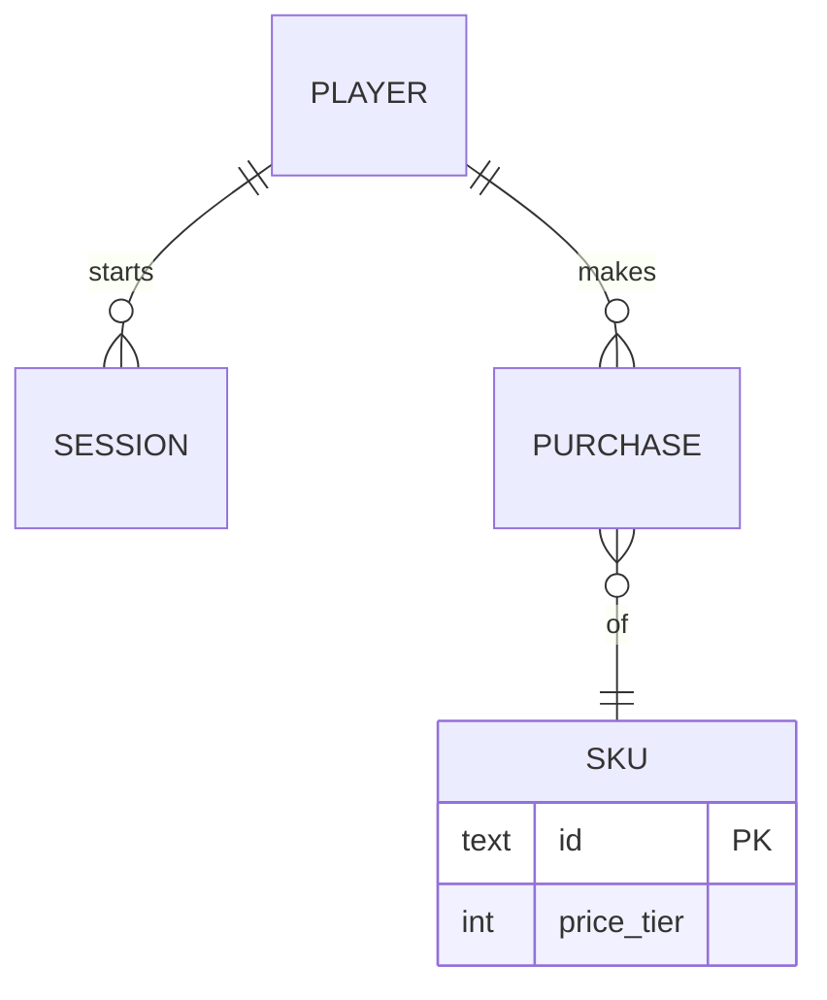
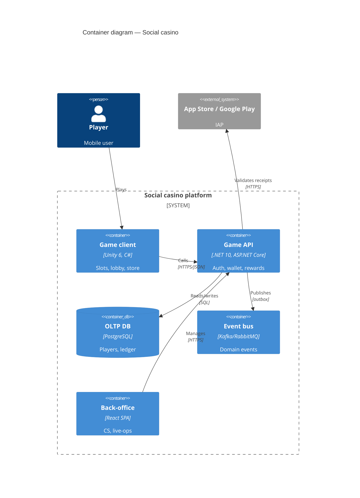
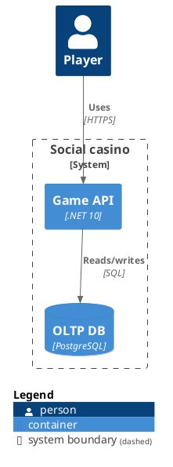

# Diagrams as code (Mermaid, PlantUML, C4)

## Which diagram for which question
| Question | Diagram | Tool default |
|---|---|---|
| Who/what interacts with the system? | C4 L1 System Context | Mermaid C4 / Structurizr |
| Which deployable units and protocols? | C4 L2 Container | Structurizr DSL or C4-PlantUML |
| Inside one service? | C4 L3 Component (only if it helps) | C4-PlantUML |
| Order of calls, failure paths | Sequence | Mermaid `sequenceDiagram` |
| Lifecycle of an entity | State | Mermaid `stateDiagram-v2` |
| Data structure | ER | Mermaid `erDiagram` |
| Domain types/contracts | Class | Mermaid `classDiagram` |
| Business process | Flowchart (BPMN-lite) | Mermaid `flowchart` (see business-analyst process-modeling) |
| Infra/runtime placement | C4 Deployment | Structurizr / C4-PlantUML |
Rules: one diagram = one question; ≤ ~15 nodes; title + legend when colors/styles carry meaning;
diagrams live next to the spec in markdown; GitHub/GitLab render ```mermaid natively.

## Mermaid sequence

- Arrows: `->>` sync call, `-->>` reply, `-)` async message, `-x` lost/failed.
- Blocks: `alt/else`, `opt`, `loop`, `par/and`, `critical/option`, `break`, `rect rgb(…)`.
- `+`/`-` on arrows = activate/deactivate; `autonumber` for step refs in specs.
- Gotchas: `;` and `#` in text need escaping (`#59;`); avoid the word `end` unquoted in labels.

## Mermaid state

- Label transitions `event [guard] / action`; `<<choice>>`, `<<fork>>`, `<<join>>` pseudo-states;
  `note right of X` for invariants. Every non-final state needs an exit (timeouts!).

## Mermaid class

Relations: `<|--` inheritance, `*--` composition, `o--` aggregation, `-->` association,
`..>` dependency, `..|>` realization. Visibility `+ - # ~`.

## Mermaid ER

Cardinality pairs: `|o` zero/one, `||` exactly one, `}o` zero/many, `}|` one/many;
`--` identifying (solid), `..` non-identifying (dashed). Attribute keys `PK`, `FK`, `UK`.

## Mermaid C4 (experimental — syntax may change; compatible with C4-PlantUML)

Types: `C4Context`, `C4Container`, `C4Component`, `C4Dynamic`, `C4Deployment`. Elements:
`Person`, `System`, `System_Ext`, `SystemDb`, `Container`, `ContainerDb`, `ContainerQueue`,
`Component`, `*_Boundary`, `Rel`, `BiRel`. Layout: `UpdateLayoutConfig($c4ShapeInRow="3")`.

## C4 model rules (c4model.com)
- Levels: 1 System Context (people + systems), 2 Container (separately deployable/runnable
  units: apps, DBs, queues), 3 Component (inside a container), 4 Code (rarely drawn; use IDE).
- Every element: name, type, technology, 1-line responsibility. Every relationship: verb
  phrase + protocol/tech ("Publishes events to", "gRPC"). Unidirectional arrows.
- Include a key/legend; avoid ambiguous acronyms; draw L1 + L2 for every system, L3 only when
  a container is complex; supplementary: dynamic (numbered flows) and deployment diagrams.
- "Container" ≠ Docker container. A Unity client and a DB are both containers.

## Structurizr DSL (model once, many views)
```
workspace "Social casino" {
  model {
    player = person "Player"
    store = softwareSystem "App stores" { tags "External" }
    sc = softwareSystem "Social casino" {
      app = container "Game client" "Slots, lobby" "Unity 6"
      api = container "Game API" "Wallet, rewards" ".NET 10"
      db  = container "OLTP DB" "Players, ledger" "PostgreSQL" { tags "Database" }
    }
    player -> app "Plays"
    app -> api "Calls" "HTTPS/JSON"
    api -> db "Reads/writes" "SQL"
    api -> store "Validates receipts" "HTTPS"
  }
  views {
    systemContext sc { include * autolayout lr }
    container sc { include * autolayout lr }
    styles { element "Database" { shape cylinder } element "External" { background #999999 } }
  }
}
```
Render: Structurizr Lite/vNext (Docker) or export to PlantUML/Mermaid via Structurizr CLI
(verify: current Structurizr tooling names).

## PlantUML essentials

- Sequence: `participant`, `->` / `-->`, `activate`, `alt/else/end`, `group`, `== section ==`,
  `...delay...`, `autonumber`. Same structure as Mermaid; PlantUML better for very large diagrams.
- Activity (swimlanes `|Lane|`), state, component, deployment, timing, and `@startjson` / `@startyaml`
  for payload visualization. Requires Java/Graphviz or a PlantUML server to render.

## Review checklist
- [ ] Diagram answers one stated question; title present; ≤ ~15 nodes.
- [ ] Sequence includes failure branches (timeout, duplicate, partner error) and retries.
- [ ] State diagram: all states reachable, every non-final state has an exit, guards labeled.
- [ ] C4 relationships labeled with intent + protocol; externals visually distinct; legend.
- [ ] Names match the spec/contract identifiers (service names, endpoints, entities).
- [ ] Renders without errors (Mermaid Live Editor / PlantUML server) before handoff.

## Sources
- Mermaid sequence diagram syntax https://mermaid.js.org/syntax/sequenceDiagram.html
- Mermaid state diagrams https://mermaid.js.org/syntax/stateDiagram.html
- Mermaid class diagrams https://mermaid.js.org/syntax/classDiagram.html
- Mermaid C4 diagrams (experimental) https://mermaid.js.org/syntax/c4.html
- C4 model (Simon Brown) https://c4model.com/
- Structurizr DSL language reference https://docs.structurizr.com/dsl/language
- C4-PlantUML https://github.com/plantuml-stdlib/C4-PlantUML
- PlantUML sequence diagrams https://plantuml.com/sequence-diagram
