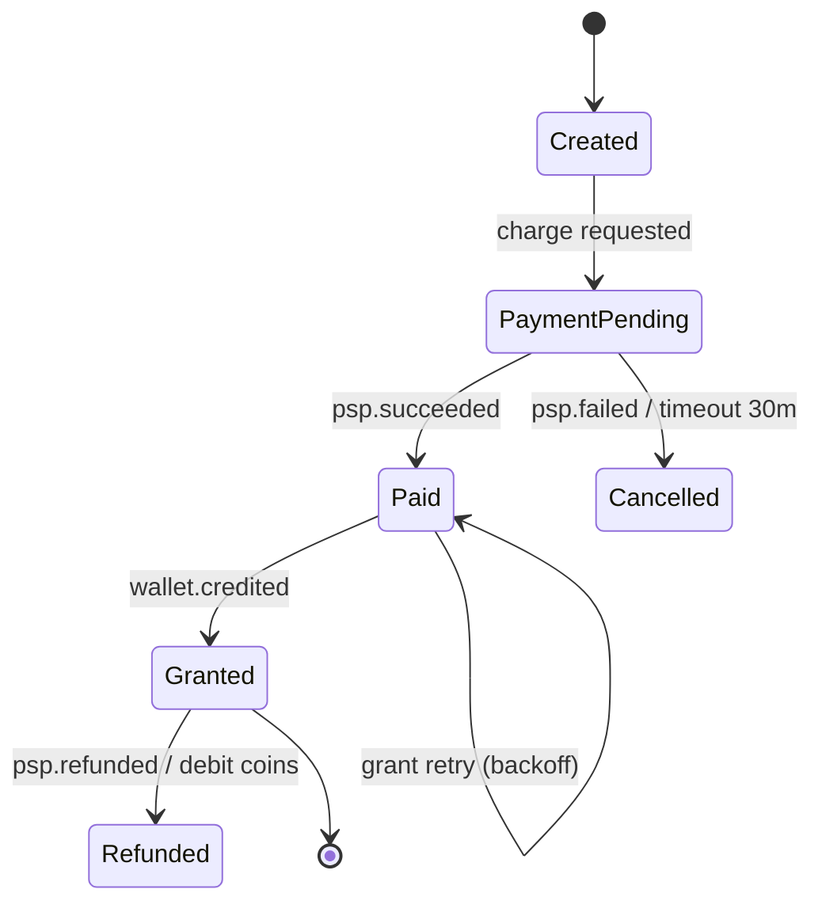

# Integration patterns

## Sync vs async — decision rules
| Choose | When | Cost |
|---|---|---|
| Sync request/response (REST/gRPC) | caller needs the answer now (balance, purchase validation result) | temporal coupling; latency adds up; cascading failures |
| Async command (queue) | work can complete later; need load leveling (payout, export, emails) | status tracking, eventual completion UX |
| Async event (pub/sub) | many consumers react to a fact (wallet.credited → analytics, CRM, achievements) | eventual consistency, dedupe, ordering per key |
| Webhook (outbound/inbound HTTP callback) | cross-org notification (PSP, store, ad network) | signature, retries, out-of-order |
| Polling / reconciliation | partner has no callbacks, or as safety net for callbacks | latency, quota |
Rules: keep player-facing critical path sync and short (≤ 2 downstream hops); everything else
async. Every async flow needs: message ID, correlation ID, idempotent consumer, DLQ, replay.

## Timeouts, retries, circuit breakers
- Every outbound call has a timeout < caller's timeout (budget: client 10 s > API 5 s > downstream 2 s).
- Retry only idempotent or idempotency-keyed operations; retry on 408/429/5xx/network, not 4xx.
- Exponential backoff with full jitter: `sleep = random(0, min(cap, base * 2^attempt))`
  (AWS Architecture Blog). Typical: base 200 ms–2 s, cap 30 s, max 3–5 attempts; honor `Retry-After`.
- Circuit breaker: open on failure ratio over a window, half-open probes; fail fast with fallback.
- .NET: `Microsoft.Extensions.Http.Resilience` `AddStandardResilienceHandler()` = rate limiter →
  total timeout (30 s) → retry (3, exponential + jitter, 2 s base) → circuit breaker (10% failure
  ratio, 30 s sampling, 5 s break) → attempt timeout (verify: defaults on Microsoft Learn page).
- Bulkheads: separate connection pools/limits per partner so a slow PSP doesn't starve gameplay.
- Unity client: `UnityWebRequest.timeout`; retry with same Idempotency-Key; exponential backoff;
  surface "retrying…" UI; persist pending grants across app restarts.

## Transactional outbox + inbox
Problem: writing DB and publishing to a broker are two systems → lost or phantom events.
```
BEGIN; UPDATE account …; INSERT ledger_entry …;
       INSERT outbox(id, type, payload, created_at) VALUES (…); COMMIT;
relay (poller every 100–500 ms or CDC/Debezium) → publish → mark outbox.sent_at
consumer: INSERT inbox(message_id) ON CONFLICT DO NOTHING → if inserted, handle; same txn as effects
```
- Ordering: partition key = aggregate ID (playerId) so per-player order holds; global order never.
- Relay is at-least-once → consumers must dedupe (inbox table or natural unique key).
- .NET options: MassTransit transactional outbox (EF Core), Wolverine, CAP, custom poller
  (verify: MassTransit v9 licensing change before choosing).
- Cleanup: purge sent outbox/inbox rows after N days (≥ max replay window).

## Sagas (multi-step business transactions)
| Style | How | Use when |
|---|---|---|
| Orchestration | one coordinator (state machine) sends commands, tracks state | ≥ 3 steps, need visibility, timeouts, compensation logic in one place |
| Choreography | services react to each other's events | 2–3 steps, loosely owned, simple compensation |
- Each step has a compensating action (refund, release hold, revoke item); compensations are
  semantic undo, not rollback; must also be idempotent and retryable.
- Persist saga state (`saga_id, step, status, deadline`); timeouts trigger compensation.
- Example — web-shop purchase: Reserve order → Charge PSP (pivot, non-compensable after
  capture except refund) → Grant items (retry until success) → Notify. Steps after the pivot
  must be retryable to completion, not compensated.


## Webhooks
### Receiving (PSP, stores, ad networks)
- Verify authenticity: HMAC signature over raw body + timestamp (reject if skew > 5 min),
  or JWS (Apple), or Pub/Sub push auth (Google RTDN); IP allowlists are secondary only.
- Respond 2xx fast (< 1–2 s; some partners require far less, e.g. LevelPlay 400 ms), enqueue,
  process async. Non-2xx → partner retries (often hours/days) → handler must be idempotent.
- Dedupe by partner event ID; tolerate out-of-order (compare state/version, fetch latest from
  partner API rather than trusting payload order).
- Reconcile: scheduled job pulls partner API (orders, voided purchases) to catch missed hooks.
- Log raw payload (redact PII/secrets) with retention for disputes.
### Sending (your platform → partners/B2B operators)
- Follow Standard Webhooks spec: `webhook-id`, `webhook-timestamp`, `webhook-signature` headers;
  retries with backoff for ~24–72 h; per-endpoint secret rotation; delivery log + manual replay.

## Third-party integration catalogue (game/IT)
| Category | Examples | Key integration rules |
|---|---|---|
| App stores | App Store Server API + Server Notifications V2; Google Play Developer API + RTDN (Pub/Sub) | validate server-side; grant idempotent on transaction/order ID; handle refunds/voids; acknowledge (Play, 3-day rule) |
| PSPs / MoR | Stripe, Adyen, PayPal, Xsolla (gaming MoR) | hosted fields/redirect (no PAN on our servers, PCI scope SAQ-A); webhooks for final status; 3DS/SCA; refunds/chargebacks feed ledger |
| Platform identity | Game Center, Google Play Games Services v2, Steam (session tickets → Web API `AuthenticateUserTicket`), Sign in with Apple | verify token server-side; map to internal player ID; link/unlink accounts |
| Analytics SDKs | Firebase/GA4, GameAnalytics, Unity Analytics, Amplitude | client SDK for behavior; server-side events for money/grants (source of truth); one internal event model |
| MMP / attribution | AppsFlyer, Adjust, Singular | S2S purchase/revenue events with dedupe; SKAdNetwork/AdAttributionKit postbacks; consent gating |
| Ad networks / mediation | AppLovin MAX, Unity LevelPlay, AdMob | rewarded ads: grant only on signed S2S callback (MAX event token, LevelPlay signature, AdMob SSV) — never on client callback alone |
| Push / messaging | FCM HTTP v1, APNs (token auth .p8) | store tokens per device; prune invalid tokens on 404/410; quiet hours |
| Anti-fraud / KYC | Sumsub, Onfido, Jumio; device integrity (Play Integrity, App Attest) | async results via webhook; hold sensitive actions until verdict |
| Customer support | Zendesk, Helpshift | pass player ID + recent txn summary; deep links into admin panel |
- Wrap every vendor behind an internal port/adapter (anti-corruption layer): internal DTOs,
  internal error codes, vendor IDs stored as external references; swap vendors without client release.
- Per integration spec: auth/credentials storage (secret manager), sandbox vs prod endpoints,
  rate limits/quotas, SLA, webhook list, error mapping, reconciliation, monitoring/alerts, owner.

## Consistency patterns cheat sheet
| Need | Pattern |
|---|---|
| Exactly-once effect | at-least-once delivery + idempotent consumer |
| Read your own write after async | return new state in sync response; or version token |
| Query across services | API composition (BFF) or CQRS read model fed by events |
| Prevent double spend | DB transaction + optimistic version / row lock on account |
| Long partner latency | async + status resource + push notification |
| Partner down | queue + retry with backoff; feature flag to disable; graceful UX |

## Integration review checklist
- [ ] Sequence diagram incl. timeout, retry, duplicate, partner-down, and reconciliation paths.
- [ ] Every message/hook has an ID + dedupe store; consumers idempotent.
- [ ] No dual writes; outbox (or CDC) for DB → broker.
- [ ] Timeouts and retry budgets specified per hop; circuit breakers on partner calls.
- [ ] Webhook signatures verified; secrets rotated; raw payload logged with redaction.
- [ ] Money flows reconcile daily against partner reports; drift alerts defined.
- [ ] Vendor isolated behind adapter; sandbox test plan; monitoring + owner named.

## Sources
- microservices.io, Transactional outbox / Saga patterns (Chris Richardson) https://microservices.io/patterns/data/transactional-outbox.html
- AWS Architecture Blog, "Exponential Backoff And Jitter" https://aws.amazon.com/blogs/architecture/exponential-backoff-and-jitter/
- Microsoft Learn, Build resilient HTTP apps https://learn.microsoft.com/dotnet/core/resilience/http-resilience
- Standard Webhooks specification https://www.standardwebhooks.com/
- AppLovin MAX server-to-server callback https://support.applovin.com/en/max/faq/how-server-to-server-callback-works
- Unity LevelPlay server-to-server callback https://docs.unity.com/en-us/grow/levelplay/platform/settings/server-to-server-callback
- Google AdMob server-side verification (Unity) https://developers.google.com/admob/unity/ssv
- Gregor Hohpe & Bobby Woolf, "Enterprise Integration Patterns", Addison-Wesley, 2003
