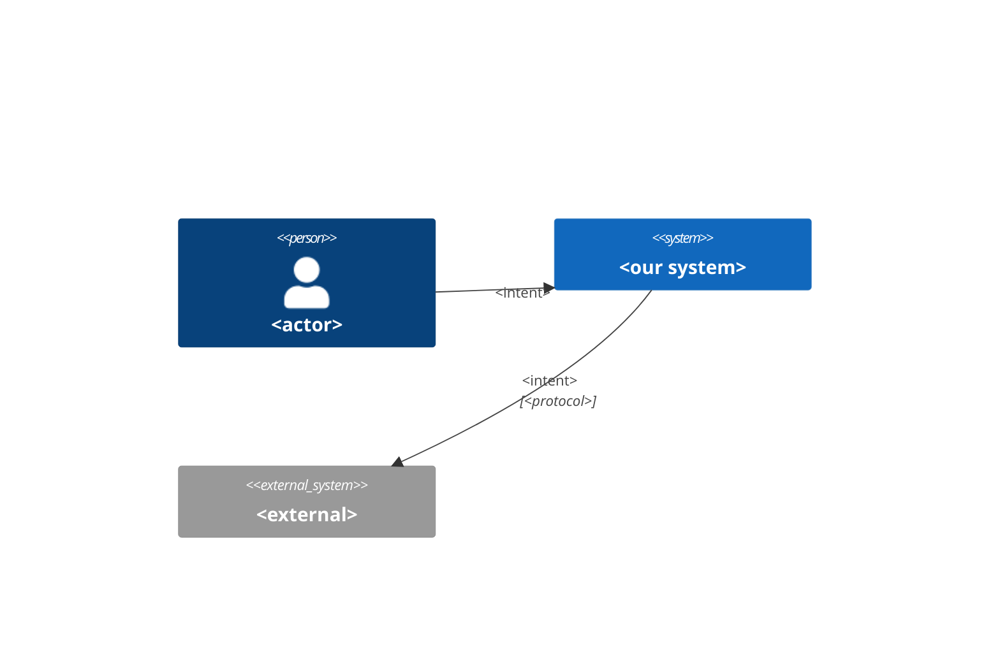
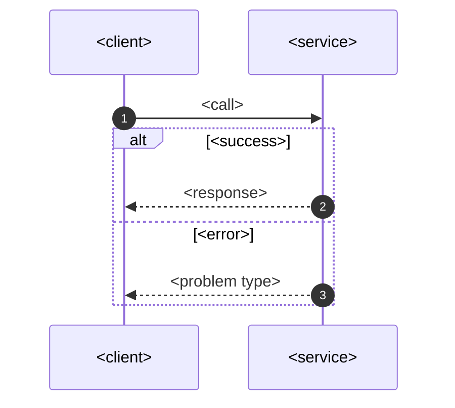

# System spec: <feature / integration name>
Version: <0.1>  Date: <YYYY-MM-DD>  Owner: system-analyst  Status: draft | review | frozen
Traces: stories <US-n…> · rules <BR-n…> · NFR <NFR-n…> · ADR <ADR-NNN>

## 1. Scope
- In: <operations/flows covered>  · Out: <explicit exclusions>
- Actors/systems: <Unity client, Game API, admin panel, PSP, store, analytics…>

## 2. Context

## 3. Flows (one per non-trivial AC; include failure branches)
### F-1 <name> (US-n)

- Timeouts/retries: <per hop> · Idempotency: <key + scope + TTL> · Consistency: <sync/eventual>

## 4. Operations / contract
| Op ID | Method + path / RPC / event | Story | Auth scope | Idempotent? | p95 / rate limit |
|---|---|---|---|---|---|
| OP-1 | `POST /v1/<resource>` | US-n | `<scope>` | key | <200 ms / 10 rps/user> |
- Contract files: `api/openapi.yaml` · `api/asyncapi.yaml` · `api/<svc>.proto`

## 5. Data
- Entities + ER: <link data-model.md or inline erDiagram>
- New/changed fields (data dictionary rows): <entity.attr | type | null | constraint | PII>
- Migration/backfill: <steps, reversibility>

## 6. States

## 7. Errors (RFC 9457)
| code | HTTP/gRPC | type URI | retryable | client behavior (UX) |
|---|---|---|---|---|
| <CODE> | <409> | <https://errors…/x> | no | <message, next step> |

## 8. Non-functional
- Performance: <p95, throughput, payload limits> · Availability/degradation: <fallback>
- Security/privacy: <authn/z, PII fields, audit events> · Observability: <logs, metrics, traces, alerts>

## 9. Compatibility & versioning
- Change type: additive | breaking (→ new version) · Min client version: <x.y> · Deprecations: <…>

## 10. Analytics events
- <event_name: trigger, properties, emitted by client|server> (align with data-analyst tracking plan)

## 11. Test hints
- Contract tests: <ops> · Edge cases: <duplicate, timeout, concurrency, boundary values>

## 12. Open questions
| # | Question | Owner | Due |
|---|---|---|---|
