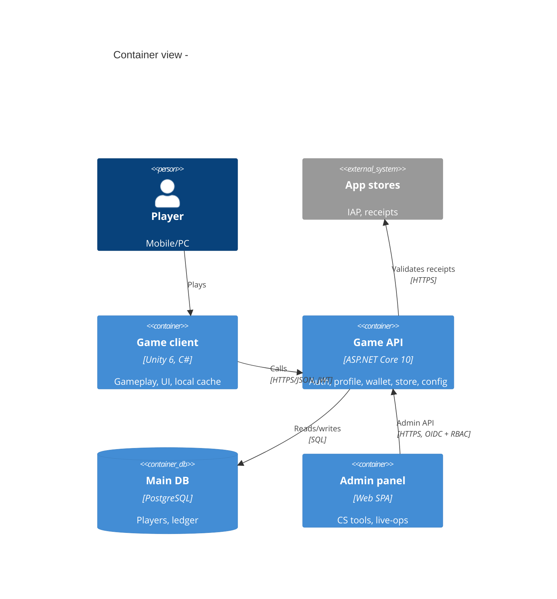

# ADRs and architecture documentation

## ADR practice
- Write an ADR when a decision is architecturally significant: hard/costly to reverse, affects
  quality attributes, crosses module/team boundaries, adds a technology/vendor, or changes a
  public contract. Not for library-internal choices a reviewer can judge in a PR.
- Format: team-protocol `templates/adr.md` (Nygard-style: Context / Options / Decision /
  Consequences, status). For complex choices use MADR 4.0 sections: Context and Problem
  Statement, Decision Drivers, Considered Options, Decision Outcome (+ Consequences,
  Confirmation), Pros and Cons of the Options, More Information.
- Location `.team/decisions/ADR-NNN-<slug>.md` (or repo `docs/adr/` if the project has it — follow
  the project). Number sequentially; never reuse numbers.
- Lifecycle: proposed → accepted → (deprecated | superseded by ADR-NNN). Accepted ADRs are
  immutable; change = new ADR that supersedes; add a back-link line to the old one.
- Good ADR checklist:
  - [ ] Context states forces with numbers (load, team, deadline, cost) and links specs.
  - [ ] ≥ 2 real options incl. "do nothing/keep current"; each with pros, cons, cost/risk.
  - [ ] Decision says what and why in ≤ 5 lines; names who decided and date.
  - [ ] Consequences include negatives, follow-up tasks, and a revisit trigger.
  - [ ] Confirmation: how compliance is checked (architecture test, lint rule, review item).
- Y-statement (one-liner for small decisions): "In the context of <use case>, facing <concern>,
  we decided for <option> and against <others>, to achieve <quality>, accepting <downside>."
- Common game/backend ADR topics: engine version/upgrade, render pipeline, DI container,
  netcode library and authority model, backend hosting (UGS/PlayFab/Nakama/custom ASP.NET Core),
  DB (PostgreSQL vs SQL Server vs document), messaging, auth provider, serialization format,
  monorepo vs multirepo, branching model, analytics vendor.

## C4 model (Simon Brown)
| Level | Shows | Audience | Required? |
|---|---|---|---|
| 1 System context | system, users (players, CS, admins), external systems (stores, platform auth, payment, analytics, ad networks) | everyone | yes |
| 2 Container | deployable/runnable units: Unity client, game API, realtime server, admin web, DBs, cache, queue, CDN | tech team, ops | yes |
| 3 Component | major components inside one container (modules: Wallet, Profile, Store) | developers of that container | only for complex containers |
| 4 Code | classes | rarely; generate from IDE | no |
- Supplementary: system landscape (many systems), dynamic (runtime flow for a use case),
  deployment (containers mapped to infra: regions, K8s, managed services).
- Notation rules: every element has name, type, technology, one-line responsibility; every
  arrow has a label (intent + protocol, e.g., "Reads/writes balances [SQL/TCP]"); add a key/legend.
- Diagrams as code: Mermaid C4 (`C4Context`, `C4Container`) renders in GitHub/GitLab; Structurizr
  DSL for model-based multi-view. Store next to code; review in PRs.

## arc42 (12 sections) — lite usage
| # | Section | Lite content (≤ 1 screen each) |
|---|---|---|
| 1 | Introduction and goals | top 3-5 quality goals, stakeholders |
| 2 | Constraints | tech, org, legal, platform constraints |
| 3 | Context and scope | C4 L1 + external interfaces table |
| 4 | Solution strategy | key decisions summary with ADR links |
| 5 | Building block view | C4 L2 (+ L3 for complex containers) |
| 6 | Runtime view | 3-5 key scenarios (login, purchase, match, config refresh) as sequence diagrams |
| 7 | Deployment view | environments, regions, scaling units |
| 8 | Crosscutting concepts | auth, error handling, logging/telemetry, config, i18n, persistence |
| 9 | Architecture decisions | ADR index |
| 10 | Quality requirements | quality tree + scenarios (see quality-attributes.md) |
| 11 | Risks and technical debt | link `.team/risks.md`, `tech-debt.md` |
| 12 | Glossary | domain terms |
- `.team/specs/architecture/overview.md` = sections 1-6, 8, 10 at kickoff; add 7, 11 before beta.
- Keep docs where devs look (repo, `docs/`), short, and tied to ADRs; delete stale docs.

## RFC process (cross-team or high-risk changes)
1. Author writes `.team/specs/architecture/rfc-NNN-<slug>.md`: problem, goals/non-goals,
   proposal, alternatives, migration/rollout, risks, open questions, cost.
2. Review window (e.g., 2-5 working days; agents: one review round) with named reviewers:
   affected leads, security-engineer for auth/data/payments, devops-sre-engineer for ops.
3. Comments resolved or explicitly deferred; tech-lead-architect decides (or escalates to human).
4. Outcome recorded as ADR(s); RFC marked accepted/rejected with link.
- Use RFC for: new service, new datastore, public API breaking change, engine upgrade, auth
  changes, cross-cutting libraries. Use a plain ADR for single-team significant decisions.

## Tech radar
- Rings (Thoughtworks): Adopt (default choice), Trial (use on a real project with care),
  Assess (explore, spike), Hold (don't start new work with it).
- Quadrants: techniques, tools, platforms, languages & frameworks.
- Studio radar file `.team/specs/architecture/tech-radar.md`: table item | quadrant | ring |
  rationale | ADR link | reviewed date. Review every 6 months or on major version changes.
- Example entries (verify against project): Adopt — Unity 6.3 LTS, .NET 10 LTS, PostgreSQL,
  VContainer, UniTask/Awaitable, OpenTelemetry, xUnit v3. Trial — Aspire for local dev,
  MemoryPack. Assess — Unity CoreCLR (Unity 7.0 alpha). Hold — Built-in RP for new projects,
  .NET 8 for new services (EOL 2026-11), commercial-licensed libs without budget (see stack-dotnet).

## Documentation minimum per milestone
| Milestone | Architecture docs |
|---|---|
| Prototype | brief ADRs only (engine, backend option), spike reports |
| Vertical slice | overview (C4 L1-L2), NFR v1, key ADRs, standards.md |
| Alpha | runtime views for critical flows, contracts versioning policy, threat model (security-engineer) |
| Beta | deployment view, capacity plan + load test results, runbooks (devops-sre-engineer), debt register |
| Live | ADR index current, incident learnings fed back to ADRs |

## Sources
- Michael Nygard, "Documenting Architecture Decisions", 2011 https://cognitect.com/blog/2011/11/15/documenting-architecture-decisions
- ADR community site and MADR 4.0.0 (2024-09-17) https://adr.github.io/ , https://adr.github.io/madr/
- Simon Brown, "The C4 model" https://c4model.com/
- arc42 template overview https://arc42.org/overview ; docs https://docs.arc42.org/home/
- Thoughtworks Technology Radar https://www.thoughtworks.com/radar
- Mermaid C4 diagrams docs https://mermaid.js.org/syntax/c4.html
