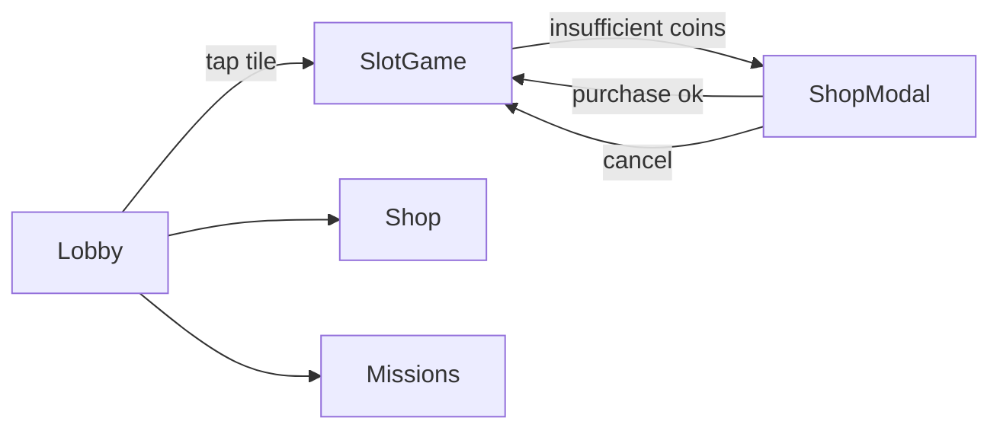

# UX process for games and admin tools

## Method picker
| Question | Method | Cost | Output |
|---|---|---|---|
| Why do players/users behave X? | 1:1 interviews (5-8 per segment) | M | needs, quotes, jobs |
| Can they complete task Y? | moderated usability test (5 users/round) | M | task success, issues by severity |
| Is the UI obviously broken? | heuristic evaluation (2-3 evaluators) | L | issue list vs Nielsen-10 |
| Where do they drop? | funnel analytics (data-analyst) | L | step conversion |
| Do they understand the mechanic? | think-aloud playtest + post-session quiz | M | comprehension rate |
| Which variant performs? | A/B test (data-analyst) | H | metric delta with CI |
| How do they group content? | card sort (open 15+ users / closed) | L | IA categories |
| Can they find item Z? | tree test (50+ users, remote) | L | findability % |
- Rule: qualitative (why) before quantitative (how many). 5 users find most usability issues
  in a round (Nielsen 2000); run more small rounds, not one big one.
- Agent constraint: you cannot run sessions. Write the plan, script, and analysis template;
  the human runs them; you synthesize notes into issues.

## Heuristic evaluation (Nielsen's 10, NN/g 2024 review)
| # | Heuristic | Game/app check |
|---|---|---|
| 1 | Visibility of system status | loading/progress shown; currency changes animated at source and target |
| 2 | Match system and real world | player vocabulary, not internal names (`SKU_GEMS_3`) |
| 3 | User control and freedom | back/close on every modal; undo for destructive; skip cutscenes |
| 4 | Consistency and standards | same button = same place/color; platform confirm/back buttons |
| 5 | Error prevention | confirm purchases > threshold; disable invalid actions with reason |
| 6 | Recognition over recall | show costs/requirements inline; icons + labels |
| 7 | Flexibility and efficiency | shortcuts, multi-buy, quick-collect, remembered filters |
| 8 | Aesthetic and minimalist | one primary CTA per screen; remove decorative noise near data |
| 9 | Recover from errors | plain-language error + next action + retry; never error codes alone |
| 10 | Help and documentation | contextual tips, glossary in admin, FAQ link from store |
Severity (Nielsen scale): 0 not a problem, 1 cosmetic, 2 minor, 3 major (fix before release),
4 catastrophe (blocks task/money). Log: `ID | screen | heuristic | severity | evidence | fix`.

## Game-specific lenses (Hodent, The Gamer's Brain, 2017)
- Two pillars: **usability** (can players use it) and **engage-ability** (do they want to).
- Brain limits to design for: perception is subjective (test icons), attention is scarce
  (one new thing at a time), working memory is small (don't require recall across screens),
  memory decays (re-teach after breaks).
- Usability checks: clear signs and feedback, consistency, low workload, error prevention,
  form follows function, flexibility. Engage-ability: motivation (competence, autonomy,
  relatedness), emotion (game feel), game flow (difficulty and learning curve).

## Personas-lite (≤ 8 lines each; data-backed or labeled "assumed")
```
P-1 <name>: <segment, e.g. casual slots player 45+, plays 3x10 min/day on phone>
Goals: <top 3> | Frustrations: <top 3> | Context: <device, one-hand, commute, sound off>
Spend: <non-payer/minnow/dolphin/whale or admin role> | Tech comfort: <L/M/H>
Accessibility: <e.g. presbyopia → text size; colorblind 8% men>
Quote: "<verbatim if from research>"
```
- Admin panels: personas = roles (CS agent, LiveOps manager, finance, compliance auditor).
- Never invent research quotes; mark assumed personas and validate later.

## Journey map (table, one per key scenario)
| Stage | Action | Touchpoint/screen | Thinking/feeling | Pain | Opportunity | Metric |
|---|---|---|---|---|---|---|
| Discover | sees ad | store page | "looks fun" | - | - | CTR |
| First session | FTUE | SCR-FTUE-001..005 | confused by currency | 2 currencies | delay 2nd currency | D0 tutorial completion |

## Information architecture
- Inventory content/features → group (card sort) → label (player words) → navigation model.
- Game hub patterns: hub-and-spoke (lobby → feature → back), tab bar (≤ 5 tabs mobile),
  stack navigation (push/pop) for depth; modal only for blocking decisions.
- Depth rule: daily actions ≤ 2 taps from hub; settings/legal may be deeper.
- Admin IA: left nav by object (Players, Transactions, Offers, Events, Reports), list → detail
  → action; global search by player ID/email; breadcrumbs beyond depth 2.
- Navigation map in Mermaid:


## User flow conventions
- One flow per goal; include: entry points, decision diamonds, system steps (server call),
  error/offline/timeout branches, exit. Label edges with the trigger.
- Mark server round-trips `[[API: POST /purchase]]` so system-analyst can align contracts.
- Count interactions on happy path; record as `steps: N` in the flow header.

## FTUE / onboarding (games)
| Principle | Rule of thumb |
|---|---|
| Teach by doing | interactive steps, not text walls; GAG basic: "include interactive tutorials" |
| One concept per step | introduce currency, then upgrade, then social - never all in session 1 |
| Time to fun | first core-loop payoff in < 60 s from launch (casual/slots: first spin < 30 s) (verify per genre benchmarks) |
| Gate permissions | ask push/ATT/notifications after value is shown, with a pre-prompt explaining why |
| Skippable | returning players and reinstalls can skip; tutorial resumable after crash |
| Progressive disclosure | lock/hide features until relevant; unlock moment = teaching moment |
| Measure | per-step funnel event `tutorial_step {step_id, duration_ms}`; drop > 10% at a step = fix |
| Account | defer login/registration until after first session where store and law allow |
- Casino/social casino FTUE: free coin grant visible, first spin guided, explain bet change and
  paytable, show where to get more coins; no pressure-to-buy in first session.
- Re-onboarding: after feature updates show "What's new" once; after 7+ days absence remind
  key controls (memory decay).

## Research artifacts to write
- `ux-test-plan-<feature>.md`: goals, participants (screener), 5-7 tasks with success criteria,
  script (neutral wording), metrics (success %, time, errors, SEQ 1-7), consent note.
- `ux-heuristic-<area>.md`: severity-sorted issue log + top 5 fixes.
- `ux-findings-<round>.md`: issue, frequency (n/5), severity, evidence, recommendation, owner.

## Sources
- NN/g, "10 Usability Heuristics for User Interface Design" (rev. 2024) https://www.nngroup.com/articles/ten-usability-heuristics/
- NN/g, "Why You Only Need to Test with 5 Users" (2000) https://www.nngroup.com/articles/why-you-only-need-to-test-with-5-users/
- NN/g, "Severity Ratings for Usability Problems" https://www.nngroup.com/articles/how-to-rate-the-severity-of-usability-problems/
- Celia Hodent, The Gamer's Brain (CRC Press, 2017)
- Game Accessibility Guidelines, Basic https://gameaccessibilityguidelines.com/basic/
